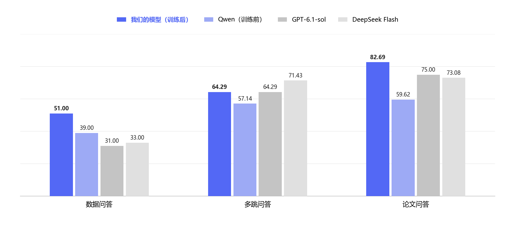

# 学术大模型

**基于 Qwen 的论文理解与问答模型**

本项目由东南大学 COIN 实验室开发，围绕学术论文中的内容理解与问答，对 Qwen 模型进行后训练。我们利用学术知识图谱组织论文证据、构造问答数据，帮助模型学习根据论文内容回答问题。

模型使用时输入论文文本和问题，**无需显式输入知识图谱**。我们计划在 Hugging Face 发布合并 LoRA 后的完整模型权重。

> 正式模型名称与基础模型的准确版本待确认。

## 模型下载

| 模型 | 基础模型 | 权重 | 下载 |
|---|---|---|---|
| 学术大模型（名称待定） | Qwen（具体版本待核实） | 合并 LoRA 后的完整权重 | Hugging Face 链接待补充 |

模型卡草稿见 [Hugging Face Model Card](huggingface/README.md)。模型发布后，将在此补充权重地址和硬件要求。

## 模型表现

下图展示现有评测记录中的准确率，蓝色标出我们的训练后模型：



## 方法与数据

我们以学术论文为知识来源，构建「**论文解析 → 知识图谱 → 问答数据 → 模型微调**」的数据处理流程。知识图谱用于组织证据、构造监督，训练后的模型则直接根据论文文本和问题生成回答。

### 从论文构建知识图谱

首先使用 MinerU 解析论文，保留章节、段落、表格、公式和来源位置等信息。然后围绕研究任务定义实体类型、关系和属性，从文本、表格、公式及相关图文上下文中抽取知识，例如研究对象、方法、实验结果和论文中的结论。

抽取的知识与原文证据及其位置关联，再通过语义对齐、冲突检测和一致性检查，整理为可追溯的学术知识图谱。这使后续构造问答时能够回到论文内容，检查答案所依据的信息。

### 从图谱构造问答数据

针对候选问题和答案，我们在局部图谱中检索能够支持答案的证据路径，并加入语义相关、但不足以推出答案的困难干扰。通过调整支持证据和干扰信息，构造不同难度的问答环境，同时要求保留回答问题所需的信息。

教师模型基于问题和结构化环境生成答案、推理过程与证据映射。经过答案一致性、证据覆盖等检查后，再将图谱中的知识映射回论文段落、表格或公式位置，形成以论文文本为上下文的问答样本。

训练数据包括直接文本问答和图谱—文本双视图构造的样本：前者覆盖概念与局部事实，后者侧重多证据组合和干扰排除。样本内容包括论文上下文、问题、文本推理、答案、证据位置和难度标签；方法设计中还包含由易到难的课程安排。

### 数据规模与模型训练

目前统计约涉及 **1 万篇论文**和 **2—3 万条训练数据**，均为近似值。我们使用这些数据对 Qwen 系列模型进行 LoRA 微调，计划发布合并 LoRA 后的完整权重。

数据来源、精确规模、学科分布和公开范围待进一步确认；更多细节见 [方法与数据](docs/method-and-data.md)。

## 问答示例

真实的论文片段、用户问题和模型回答将在模型发布后补充。

## 使用方法

使用 Hugging Face Transformers 加载模型并进行推理。模型首次加载时会从 Hugging Face 下载权重：

```bash
pip install torch transformers accelerate
```

将示例中的 `YOUR_ORG/YOUR_MODEL` 替换为实际的 Hugging Face 模型 ID：

```python
import torch
from transformers import AutoModelForCausalLM, AutoTokenizer

model_id = "YOUR_ORG/YOUR_MODEL"
tokenizer = AutoTokenizer.from_pretrained(model_id)
model = AutoModelForCausalLM.from_pretrained(
    model_id, torch_dtype="auto", device_map="auto"
)

paper_text = "在这里粘贴论文内容。"
question = "这篇论文的主要贡献是什么？"
messages = [{"role": "user", "content": f"论文内容：\n{paper_text}\n\n问题：{question}"}]
prompt = tokenizer.apply_chat_template(
    messages, tokenize=False, add_generation_prompt=True
)
inputs = tokenizer(prompt, return_tensors="pt").to(model.device)
with torch.inference_mode():
    outputs = model.generate(**inputs, max_new_tokens=512, do_sample=False)
answer = tokenizer.decode(outputs[0][inputs.input_ids.shape[-1]:], skip_special_tokens=True)
print(answer)
```

也可以使用仓库中的[命令行推理示例](examples/infer.py)。以上示例尚待用最终发布的权重验证，具体依赖版本、输入格式和硬件要求将在发布时确认。

## 项目文档

- [模型卡](docs/model-card.md)
- [方法与数据](docs/method-and-data.md)
- [发布前待补充清单](docs/release-checklist.md)

## 许可与引用

模型权重、代码、训练数据与原始论文的许可及开放范围待分别确认。论文或技术报告和引用方式将在确定后补充。
